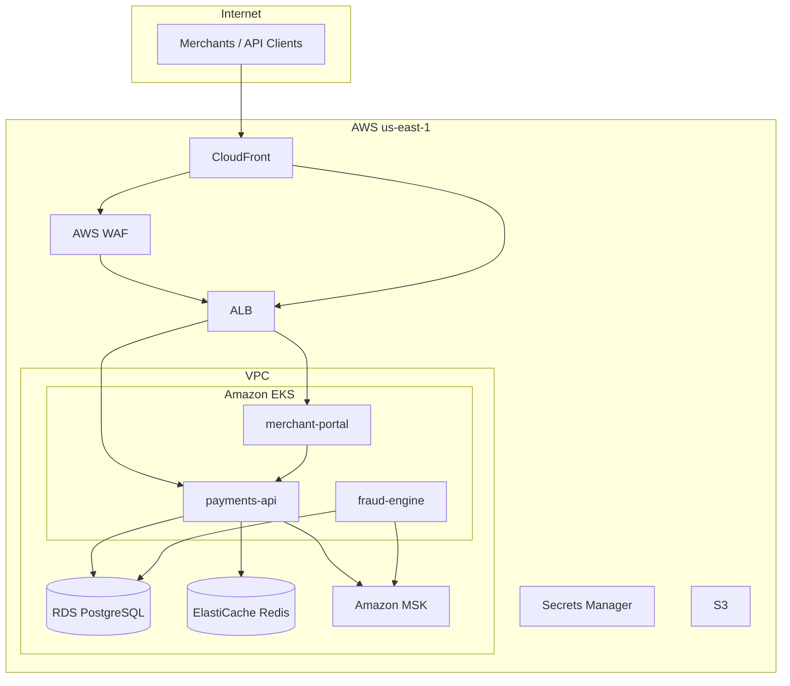

# TransactEdge Infrastructure

Infrastructure-as-code and platform tooling for [TransactEdge](https://transactedge.com), a B2B payments infrastructure company. This repository defines the AWS cloud infrastructure, Kubernetes deployment manifests, observability stack, and CI/CD pipelines that run **payments-api**, **fraud-engine**, and **merchant-portal** in production.

Owned by **Platform Engineering**. Subject to PCI DSS and SOC 2 compliance requirements.

## Application Repositories

| Repository | Description |
|---|---|
| [payments-api](https://github.com/transactedge/payments-api) | Go payment processing API |
| [fraud-engine](https://github.com/transactedge/fraud-engine) | Python real-time fraud detection engine |
| [merchant-portal](https://github.com/transactedge/merchant-portal) | Next.js merchant self-service portal |
| [shared-contracts](https://github.com/transactedge/shared-contracts) | Protobuf/OpenAPI cross-service contracts |

## Architecture



Full architecture documentation: [docs/architecture.md](docs/architecture.md)

## Repository Layout

```
infra/
├── terraform/
│   ├── bootstrap/           # Remote state backend (S3 + DynamoDB)
│   ├── modules/             # Reusable Terraform modules
│   │   ├── vpc/             # VPC, subnets, NAT, route tables
│   │   ├── eks/             # EKS cluster, node groups, IRSA
│   │   ├── rds/             # PostgreSQL with encryption
│   │   ├── elasticache/     # Redis replication group
│   │   ├── msk/             # Managed Kafka cluster
│   │   ├── s3/              # Audit logs, settlement files, documents
│   │   ├── iam/             # IRSA roles per service
│   │   ├── alb/             # Application Load Balancer + WAF
│   │   ├── cloudfront/      # CDN distribution
│   │   └── secrets-manager/ # Application secrets
│   └── environments/
│       ├── dev/
│       ├── staging/
│       └── production/
├── helm/charts/
│   ├── payments-api/        # Deployment, Service, HPA, Ingress, ExternalSecret
│   ├── fraud-engine/
│   └── merchant-portal/
├── k8s/secrets/             # External Secrets Operator manifests
├── prometheus/              # Prometheus scrape configuration
├── grafana/                 # Dashboards and datasource provisioning
├── alerts/                  # Alert rules and Alertmanager routing
├── docs/
│   ├── architecture.md
│   ├── deployment-pipeline.md
│   ├── disaster-recovery.md
│   └── adr/                 # Architecture Decision Records
├── .github/workflows/       # Terraform plan/apply, Helm lint, reusable deploy
├── Makefile                 # Common operations
└── docker-compose.yml       # Local observability stack
```

## Prerequisites

| Tool | Version | Purpose |
|---|---|---|
| [Terraform](https://www.terraform.io/downloads) | >= 1.6.0 | Infrastructure provisioning |
| [Helm](https://helm.sh/docs/intro/install/) | >= 3.14 | Kubernetes package management |
| [kubectl](https://kubernetes.io/docs/tasks/tools/) | >= 1.29 | Kubernetes cluster interaction |
| [AWS CLI](https://aws.amazon.com/cli/) | >= 2.0 | AWS authentication |
| [tflint](https://github.com/terraform-linters/tflint) | >= 0.50 | Terraform linting |
| [Docker](https://docs.docker.com/get-docker/) | >= 24.0 | Local observability stack |

## Getting Started

### 1. Bootstrap remote state (once per AWS account)

```bash
make bootstrap-state
```

### 2. Plan infrastructure changes

```bash
# Format and validate
make tf-fmt
make tf-validate

# Plan for a specific environment
make tf-plan ENV=dev
```

### 3. Apply infrastructure (requires approval for staging/production)

```bash
make tf-apply ENV=dev
```

Production applies require GitHub Environment approval via the `terraform-apply` workflow.

### 4. Lint and render Helm charts

```bash
make helm-lint
make helm-template CHART=payments-api ENV=dev
```

### 5. Local observability stack

```bash
cp .env.example .env
make obs-up
# Grafana: http://localhost:3001 (admin / changeme)
# Prometheus: http://localhost:9090
# Alertmanager: http://localhost:9093
```

## Safe Change Process

1. Create a feature branch from `main`
2. Make changes to Terraform modules, Helm charts, or configuration
3. Open a PR — CI runs `terraform plan` and `helm lint` automatically
4. Review Terraform plan output posted as PR comment
5. Complete the [PR checklist](.github/PULL_REQUEST_TEMPLATE.md)
6. Merge to `main`
7. Apply infrastructure via `terraform-apply` workflow (manual dispatch)
8. Production requires Platform + Security approval

## Deployment Pipeline

Application repositories deploy to EKS by calling the [reusable deploy workflow](.github/workflows/reusable-deploy.yml):

```
merge to main → build image → push to ECR → helm upgrade → rollout verification
```

See [docs/deployment-pipeline.md](docs/deployment-pipeline.md) for the full promotion flow across dev → staging → production.

## Documentation

- [Architecture Overview](docs/architecture.md)
- [Deployment Pipeline](docs/deployment-pipeline.md)
- [Disaster Recovery](docs/disaster-recovery.md) — RTO/RPO targets, backup strategy, runbooks
- [Architecture Decision Records](docs/adr/) — 6 ADRs covering EKS, Terraform, Helm, promotion, observability, secrets
- [Secrets Management](k8s/secrets/README.md)
- [Contributing](CONTRIBUTING.md)
- [Security Policy](SECURITY.md)

## Environments

| Environment | VPC CIDR | EKS Cluster | Apply Approval |
|---|---|---|---|
| dev | 10.10.0.0/16 | te-dev-eks | Platform team |
| staging | 10.20.0.0/16 | te-staging-eks | Platform team |
| production | 10.30.0.0/16 | te-prod-eks | Platform + Security |

## License

Proprietary. See [LICENSE](LICENSE).

## Contact

- Platform Engineering: platform@transactedge.com
- Security: security@transactedge.com
- On-call: PagerDuty — TransactEdge Platform
