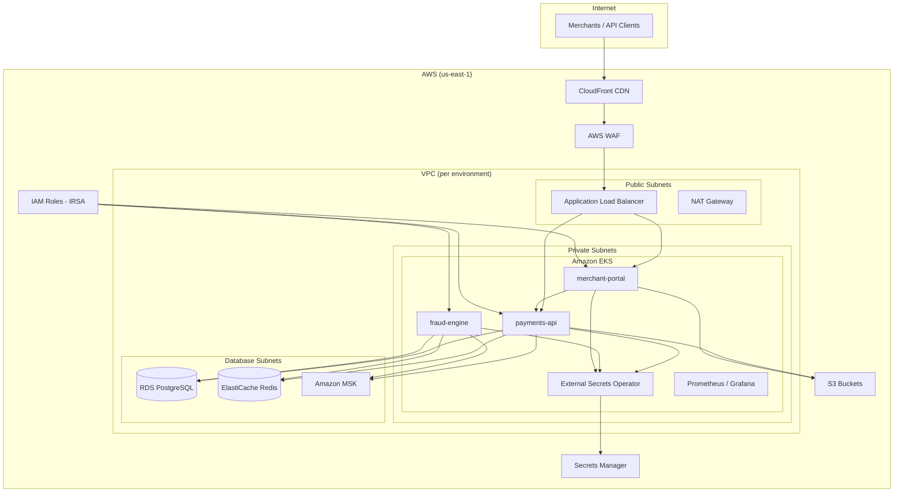

# TransactEdge Infrastructure Architecture

## Overview

This document describes the AWS infrastructure that hosts TransactEdge's payment processing platform. The infrastructure supports three core application services — **payments-api** (Go), **fraud-engine** (Python), and **merchant-portal** (Next.js) — deployed on Amazon EKS across dev, staging, and production environments.

Application source code lives in sibling repositories:

| Repository | Language | Purpose |
|---|---|---|
| [payments-api](https://github.com/transactedge/payments-api) | Go | Payment processing API |
| [fraud-engine](https://github.com/transactedge/fraud-engine) | Python | Real-time fraud detection |
| [merchant-portal](https://github.com/transactedge/merchant-portal) | Next.js | Merchant self-service portal |
| [shared-contracts](https://github.com/transactedge/shared-contracts) | Protobuf/OpenAPI | Cross-service API contracts |

## High-Level Architecture

## Network Design

Each environment runs in an isolated VPC with three subnet tiers:

- **Public subnets** — ALB, NAT gateways
- **Private subnets** — EKS worker nodes and application pods
- **Database subnets** — RDS, ElastiCache, MSK brokers (no internet route)

Inter-service communication flows through private networking. The EKS API endpoint is private in staging and production; dev allows public access from approved CIDR ranges for engineer access.

## Compute Layer

Amazon EKS hosts all application workloads. Managed node groups run in private subnets with IRSA (IAM Roles for Service Accounts) providing least-privilege AWS access per service.

| Namespace | Service | Replicas (prod) |
|---|---|---|
| `payments` | payments-api | 3–20 (HPA) |
| `fraud` | fraud-engine | 2–12 (HPA) |
| `merchant` | merchant-portal | 2–10 (HPA) |
| `monitoring` | Prometheus, Grafana, Alertmanager | Fixed |
| `external-secrets` | External Secrets Operator | 2 |

## Data Layer

| Component | Engine | Purpose |
|---|---|---|
| RDS PostgreSQL 15 | Multi-AZ (staging/prod) | Transactional data, merchant records |
| ElastiCache Redis 7 | Replication group | Session cache, rate limiting, idempotency keys |
| Amazon MSK | Kafka 3.5 | Event streaming between payments-api and fraud-engine |

All data stores are encrypted at rest (KMS) and in transit (TLS). Credentials are stored in AWS Secrets Manager and synced to Kubernetes via External Secrets Operator.

## Edge & Ingress

- **CloudFront** serves merchant-portal static assets and terminates TLS at the edge
- **ALB** routes API traffic to payments-api and merchant-portal via Kubernetes Ingress (AWS Load Balancer Controller)
- **AWS WAF** protects against OWASP Top 10 and rate-based attacks

fraud-engine is internal-only (ALB scheme: internal) and is not exposed to the public internet.

## Observability

- **Prometheus** scrapes application metrics via ServiceMonitor CRDs
- **Grafana** dashboards cover API latency, error rates, Kafka consumer lag, and database connections
- **Alertmanager** routes alerts to Slack and PagerDuty based on severity and team ownership

See `prometheus/`, `grafana/`, and `alerts/` directories for configuration.

## Secrets Management

AWS Secrets Manager is the source of truth for all credentials. External Secrets Operator syncs secrets into Kubernetes on a configurable refresh interval. Application secrets are never stored in Helm values or ConfigMaps.

See [k8s/secrets/README.md](../k8s/secrets/README.md) and [ADR-006](adr/006-secrets-management-approach.md).

## Environment Separation

| Environment | VPC CIDR | Purpose | Approval for Apply |
|---|---|---|---|
| dev | 10.10.0.0/16 | Engineering development | Auto on merge |
| staging | 10.20.0.0/16 | Pre-production validation | Platform team |
| production | 10.30.0.0/16 | Customer traffic | Platform + Security (manual gate) |

Terraform state is isolated per environment using separate S3 keys under a shared state bucket with DynamoDB locking.

## Deployment Flow

See [docs/deployment-pipeline.md](deployment-pipeline.md) for the full merge-to-production pipeline.

## Related Documents

- [Disaster Recovery](disaster-recovery.md)
- [Architecture Decision Records](adr/)
- [Contributing](../CONTRIBUTING.md)
