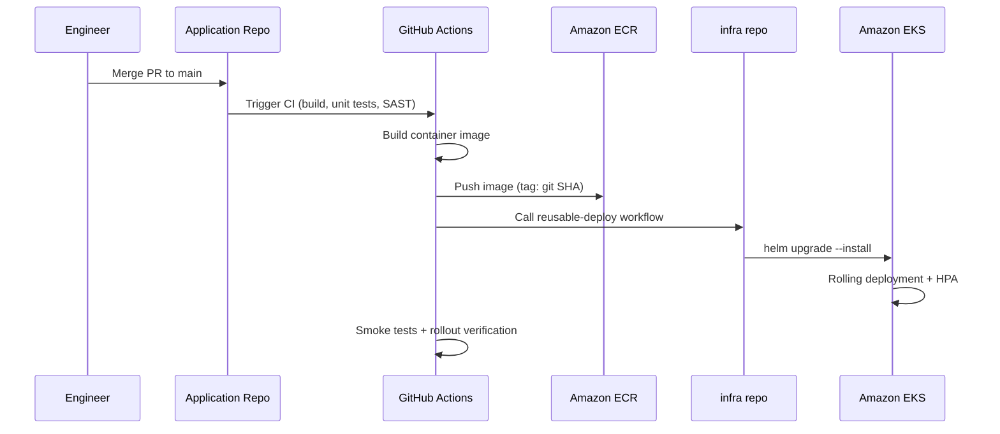

# Deployment Pipeline

This document describes the path from code merge in an application repository to a running deployment in production on TransactEdge's EKS clusters.

## Application Repositories

| Repository | Build Output | ECR Image |
|---|---|---|
| payments-api | Go binary in distroless container | `transactedge/payments-api` |
| fraud-engine | Python application container | `transactedge/fraud-engine` |
| merchant-portal | Next.js standalone build | `transactedge/merchant-portal` |

All services consume API contracts from [shared-contracts](https://github.com/transactedge/shared-contracts). Contract changes are published independently and consumed by application CI pipelines.

## Pipeline Overview



## Step-by-Step: Application Repo CI

Each application repository contains a `.github/workflows/deploy.yml` that calls the reusable workflow from this repository:

```yaml
jobs:
  deploy:
    uses: transactedge/infra/.github/workflows/reusable-deploy.yml@main
    with:
      service: payments-api
      environment: staging
      image_tag: ${{ github.sha }}
    secrets:
      AWS_ACCOUNT_ID: ${{ secrets.AWS_ACCOUNT_ID }}
      INFRA_REPO_TOKEN: ${{ secrets.INFRA_REPO_TOKEN }}
```

### Build Stage

1. Checkout source code and shared-contracts dependency
2. Run linters, unit tests, and SAST (Semgrep/Snyk)
3. Build container image with `docker build`
4. Tag image with git SHA and environment label
5. Push to Amazon ECR in the target AWS account

### Deploy Stage (via reusable workflow)

1. Checkout Helm charts from `transactedge/infra`
2. Authenticate to AWS via OIDC (IRSA-enabled GitHub Actions role)
3. Update kubeconfig for the target EKS cluster
4. Run `helm upgrade --install` with environment-specific values file
5. Wait for rollout (`kubectl rollout status`)
6. Run smoke tests against the deployed service

## Environment Promotion

| Stage | Trigger | Approval | Image Tag |
|---|---|---|---|
| dev | Merge to `main` | Automatic | `git SHA` |
| staging | Manual workflow dispatch or release branch | Platform team | `git SHA` or release tag |
| production | Manual workflow dispatch | Platform + Security (GitHub Environment protection) | Immutable release tag |

Promotion is forward-only: an image validated in staging is promoted to production without rebuilding. Production deploys reference the same image digest validated in staging.

## Helm Values per Environment

Each chart ships environment-specific values files:

```
helm/charts/payments-api/
  values-dev.yaml
  values-staging.yaml
  values-production.yaml
```

These files configure replica counts, resource limits, ingress hostnames, AWS IAM role ARNs, and Secrets Manager key paths. Image tags are overridden at deploy time via `--set image.tag=<sha>`.

## Rollback

To roll back a deployment:

```bash
# List release history
helm history payments-api -n payments

# Roll back to previous revision
helm rollback payments-api <revision> -n payments
```

For infrastructure rollbacks, revert the Terraform commit and run `terraform apply` through the approved change process.

## Infrastructure Changes

Application deployments depend on infrastructure provisioned by this repository. Infrastructure changes follow a separate pipeline:

1. PR opened → `terraform-plan.yml` posts plan output as PR comment
2. PR approved and merged
3. `terraform-apply.yml` triggered manually with environment selection
4. Production requires GitHub Environment approval from Platform and Security teams

## Monitoring Post-Deploy

After every production deploy, the on-call engineer verifies:

- Deployment rollout completed (`kubectl rollout status`)
- Error rate dashboards show no regression (Grafana: payments-api — API Latency & Errors)
- Kafka consumer lag stable (Grafana: MSK — Kafka Consumer Lag)
- No new alerts firing in Alertmanager

## Related Documents

- [Architecture Overview](architecture.md)
- [ADR-004: Multi-Environment Promotion Strategy](adr/004-multi-environment-promotion-strategy.md)
- [Disaster Recovery](disaster-recovery.md)
